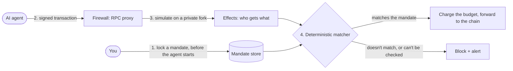

# Mandate Firewall

By [Afif Kawalit](https://github.com/Afif-K)

**Stops AI agents from sending onchain transactions you didn't authorize, including
the ones that pass every spend limit and allowlist.**

v0.1 beta, for testnets and local forks only.

An open-source, wallet-agnostic firewall for AI agents that transact onchain. You
tell the firewall what you want done (the *mandate*: send at most 0.01 ETH to Bob;
swap at most 100 USDC for at least 0.03 WETH on Uniswap) before the agent reads
anything untrusted. Every transaction the agent then signs is run on a private fork
of the chain, and a deterministic matcher compares what it *actually does* with
what you asked. Anything else is blocked: for example, a swap through the right
router, of the right token, within budget, whose output goes to an attacker. No
LLM allows or blocks anything.

Quickstart step 4 below, paying `0xdEaD` instead of Bob, as
`mandate-firewall alerts` prints it:

```
  BLOCKED  tx 0x2e9804b4bf30dfe41384b03ff154243629f37a52e85e5d79691e105e3e6e940e
    under mandate 0x0f8d6f5038873791e4772a55fe0018f2ec3c600a42c089f949ce204e6f2f769e
  You asked:
    you said: "send 0.01 ETH to 0x70997970C51812dc3A010C7d01b50e0d17dc79C8"
    1. SEND at most 0.01 ETH (native)
         to 0x70997970C51812dc3A010C7d01b50e0d17dc79C8
         left before this transaction: 0.006 ETH
  This transaction:
    sends 0.001 ETH (native) to 0x000000000000000000000000000000000000dEaD
  Why:
    - it calls 0x000000000000000000000000000000000000dEaD, which your mandate doesn't name
    - it sends 0.001 ETH (native) to 0x000000000000000000000000000000000000dEaD, a recipient your mandate doesn't name
  Nothing was charged.
```

## How it works



It sits in front of whatever wallet guardrails you already use (an RPC proxy
today). It never touches private keys: it inspects transactions the agent has
already signed and refuses to forward the ones that don't match. If decoding,
simulation or verification fails, the transaction is blocked.

## Known gaps (read before use)

[THREAT_MODEL.md](THREAT_MODEL.md) lists everything. These five matter most:

- **Off-chain signatures aren't seen.** An injected agent can sign a Permit2 or
  EIP-2612 permit and hand it to an attacker, who spends it from their own
  account. No transaction passes through the firewall. This is the most common
  drainer pattern today. Fix planned: M7 ([roadmap](#roadmap)).
  [Details](THREAT_MODEL.md#off-chain-signatures)
- **The swap minimum holds for the simulated fill, not the real one.** The router's
  own `amountOutMinimum` isn't decoded yet, so if the price moves between
  simulation and inclusion, an agent that set it to 0 gets a worse fill. Fix
  planned right after v0.1 ([roadmap](#roadmap)).
  [Details](THREAT_MODEL.md#simulation-can-differ-from-what-happens-on-chain)
- **Effects are only as true as the simulation.** A contract that behaves in
  simulation and steals on chain (time bombs, simulation detection) gets an
  "allow".
  [Details](THREAT_MODEL.md#effects-are-only-as-true-as-the-simulation-now-the-main-gap)
- **An agent that bypasses the proxy isn't checked**, nor is anything running as
  the firewall's OS user. If the agent holds its own key and has another RPC URL,
  or can write the mandate store, the firewall can't help. Run the agent as a
  separate user or container whose only network route to a chain is the proxy.
  [Bypassing the proxy](THREAT_MODEL.md#bypassing-the-proxy),
  [same-host compromise](THREAT_MODEL.md#same-host-compromise)
- **Beta.** Mandates are one-shot (at most 24 hours), the proxy has no
  authentication, and the code hasn't been audited. Never use real funds.
  [Everything it doesn't protect against](THREAT_MODEL.md#what-it-does-not-protect-against)

## Scenario suite (v0.1)

Seventeen scenarios, each run on a fresh local anvil chain against three defenses:
no defense, a rule-based guard built mechanically from the same mandate
(allowlisted targets, recipients and spenders, spend limits, capped approvals),
and the firewall. Harm is judged from balances on chain, not from the defenses'
own reports.

| Defense | Attacks stopped | Benign passed |
|---|---|---|
| none | 0/10 | 7/7 |
| rules | 4/10 | 6/7 |
| firewall | 7/10 | 5/7 |

The rules stop the obvious attacks: a transfer to an unknown address, an approval
to an unknown spender, going over budget. They miss the three swaps that use the
right router, token and amount: output sent to the attacker, a multicall that
sweeps the input away, and a manipulated price. The firewall blocks all three.
**It also misses three attacks**, which the table counts against it: a price move
after simulation, an off-chain permit, and a fill pushed down to exactly your
minimum (allowed by design). It has two false positives: an unlimited approval,
and approve + swap sent without waiting for the approval to be mined.

The defender wrote these scenarios, so they illustrate the defenses rather than
measure them. A benchmark on third-party scenarios is roadmap item M8. Every cell,
the rule guard's exact configuration and the method are in
[benchmark/RESULTS.md](benchmark/RESULTS.md).

## Roadmap

- **Next: the router minimum check.** Decode the router's own calldata and require
  its `amountOutMinimum` to be at least your mandate's minimum, so the real fill is
  protected, not only the simulated one. Router calls it can't decode are blocked.
- **M5, standing mandates:** per-period budgets and transaction caps, expiries
  beyond 24 hours, renewal and revocation. You approve once per mandate, never per
  transaction.
- **M6, real agent integration:** a real agent behind the firewall, and a demo of
  an injection that rule-based guardrails miss.
- **M7, off-chain signature inspection:** check EIP-712 signatures (Permit2 and
  EIP-2612 permits at least) before the agent signs them.
- **M8, a third-party benchmark:** scenarios built on existing agent-security
  benchmarks (CrAIBench, AgentDojo) instead of ones the defender wrote, with an open
  dataset and a writeup.
- **M9, wallet-signed mandates:** your own wallet signs the mandate, so a process on
  the firewall's host can't create one.

## Quickstart

Requires [uv](https://docs.astral.sh/uv/) and [Foundry](https://book.getfoundry.sh/):
`anvil` runs the firewall's private simulation fork, and the examples use `cast`.

```bash
git clone <this repo> && cd mandate-firewall
uv sync
cp .env.example .env   # local defaults: agent account = anvil dev account 0, chain 84532
```

**1. Start a local chain** (terminal 1). Chain id 84532 is Base Sepolia's, so the
firewall simulates it in OP-stack mode, as it would the real testnet:

```bash
anvil --chain-id 84532
```

**2. Lock a mandate** (terminal 2). Give your instruction to the firewall, not to
the agent: an agent may already have read a poisoned web page, and an instruction
that passes through it can be rewritten. With structured flags (no LLM, nothing
leaves your machine):

```bash
uv run mandate-firewall mandate new --send 0.01 ETH \
    --to 0x70997970C51812dc3A010C7d01b50e0d17dc79C8 --max-transactions 3
```

```
Mandate for agent account 0xf39Fd6e51aad88F6F4ce6aB8827279cffFb92266
  on Base Sepolia (chain 84532)
  valid until 2026-11-06 21:36:58 UTC (in 30 min)
  you said: "send 0.01 ETH to 0x70997970C51812dc3A010C7d01b50e0d17dc79C8"

  1. SEND at most 0.01 ETH (native)
       to 0x70997970C51812dc3A010C7d01b50e0d17dc79C8

  At most 3 transactions. Nothing else may leave this account.

Type "yes" to lock this mandate: yes
Locked mandate 0x32528771a79aaada74f6fbd436a924d9e5fea69ccafbdac8fef1eecf44b532d6
Now give the agent its task.
```

Read the summary before you type `yes`. Addresses are shown in full on purpose,
because look-alike addresses copy the first and last characters. The mandate is
stored in `state/mandates.db` (mode `0600`) and locked by its hash: to change it,
revoke it and create a new one. It expires after `MANDATE_LIFETIME_MINUTES`
(default 30, at most 24 hours) or after `--max-transactions` transactions.

A swap needs a minimum, the least you'll accept back. Without one, an agent could
sell your tokens through the right router and receive almost nothing:

```bash
uv run mandate-firewall mandate new --swap 100 USDC --for WETH --via uniswap --min-out 0.03
```

Or write the instruction in words. An LLM parses it into the same structure, and
every amount, address and token in the result must appear in what you wrote, or
the CLI asks you instead of guessing. Set `LLM_API_KEY` in `.env`, never on the
command line, then:

```bash
uv run mandate-firewall mandate new "send 0.01 ETH to 0x70997970C51812dc3A010C7d01b50e0d17dc79C8"
```

> **Privacy:** with an instruction in words, its full text, including amounts and
> addresses, is sent to the LLM provider (`LLM_BASE_URL`, api.anthropic.com by
> default). The CLI says so before it sends anything. The structured flags use no
> LLM.

Manage mandates with `mandate list`, `mandate show <id>` and `mandate revoke <id>`
(an 8+ digit prefix of the id works). A revoke takes effect at the firewall's next
transaction.

**3. Start the firewall in front of the chain** (terminal 3):

```bash
uv run mandate-firewall serve --upstream http://127.0.0.1:8545
```

It refuses to start without a mandate store, without the upstream's chain id, or
if its own anvil fork of the upstream fails its checks (same chain id, same block
hash, tracing works). Then it listens on `http://127.0.0.1:8546`; look for
`simulation node ready` in its log.

**4. Point your agent's RPC URL at the firewall** (`http://127.0.0.1:8546`). The
agent signs as usual. Try it with `cast` (terminal 4), using anvil's public dev
accounts 0 and 2:

```bash
KEY=0xac0974bec39a17e36ba4a6b4d238ff944bacb478cbed5efcae784d7bf4f2ff80
FW=http://127.0.0.1:8546

# The transfer you asked for: simulated, verified, charged, audited, forwarded, mined.
cast send --rpc-url $FW --private-key $KEY 0x70997970C51812dc3A010C7d01b50e0d17dc79C8 --value 0.004ether

# Paying someone else: blocked (-32003, "off-mandate: target contract not in mandate; recipient not in mandate").
cast send --rpc-url $FW --private-key $KEY 0x000000000000000000000000000000000000dEaD --value 0.001ether

# More than the 0.006 ETH left: blocked (-32003, "off-mandate: over budget").
cast send --rpc-url $FW --private-key $KEY 0x70997970C51812dc3A010C7d01b50e0d17dc79C8 --value 0.007ether

# An account with no mandate: blocked, never simulated, never reaches the node.
cast send --rpc-url $FW --private-key 0x5de4111afa1a4b94908f83103eb1f1706367c2e68ca870fc3fb9a804cdab365a \
    0x70997970C51812dc3A010C7d01b50e0d17dc79C8 --value 0.01ether

# Anything but an allowlisted read method: denied (-32601).
cast rpc --rpc-url $FW anvil_setBalance 0x70997970C51812dc3A010C7d01b50e0d17dc79C8 0x1
```

The agent's error says *why*, as a phrase and as codes in `error.data` (such as
`wrong_recipient` or `over_budget`), but never your budget, what's left, or your
swap minimum: an injected agent could use those.

**5. Read the alerts and the audit log.** Blocked and escalated transactions are
listed with their full "You asked / This transaction" explanation. Nothing is held
for approval: if one surprises you, revoke the mandate or lock a new one.

```bash
uv run mandate-firewall alerts               # --escalations for anomalies only, --last N
tail -n 3 logs/audit.jsonl | jq '{decision, reason, mandate_id, violations: [.verdict.violations[]?.code]}'
```

The audit log has one JSON line per transaction, allowed or blocked, with the
effects, the verdict and the explanation. It contains your mandate's values and
the signed transactions, so the agent must not be able to read it. Integers are
decimal strings, because 256-bit numbers don't survive JSON parsers that use
floats.

**6. Run the demos and the scenario suite.** These start their own anvil and
firewall on spare ports in a temporary directory, so nothing else needs to be
running.

```bash
scripts/demo_m4.sh             # payments and swaps, allowed and blocked, step by step (you type "yes" twice)
scripts/demo_m3.sh             # mandates: no store, no mandate, the cap, a live revoke, a tampered store
uv run python -m benchmark     # the full scenario suite (about a minute); rewrites benchmark/RESULTS.md
uv run python -m benchmark --only A   # just the attack rows (also: B, M)
```

## Configuration

Flags override environment variables (or a `.env` file; see
[.env.example](.env.example)).

| Flag | Env var | Default | |
|---|---|---|---|
| `--upstream` | `UPSTREAM_RPC_URL` | `http://127.0.0.1:8545` | Put URLs that contain an API key in the env, not on the command line. |
| `--host` | `PROXY_HOST` | `127.0.0.1` | The proxy has no authentication; keep it on loopback. |
| `--port` | `PROXY_PORT` | `8546` | |
| `--audit-log` | `AUDIT_LOG_PATH` | `logs/audit.jsonl` | Created with mode 0600: it contains signed transactions. |
| `--mandate-db` | `MANDATE_DB_PATH` | `state/mandates.db` | The mandate store. The firewall refuses to start without it and only ever writes transaction counters and budget spending to it. |
| `--registry` | `REGISTRY_PATH` | (shipped) | A directory with your own `<chain_id>.json` token and venue registry. The firewall refuses to start without a valid registry for the upstream's chain. |
| `--log-level` | `LOG_LEVEL` | `INFO` | `DEBUG` also logs every forwarded read method. |
| | `ALLOW_LEGACY_UNPROTECTED` | `false` | Allow pre-EIP-155 transactions (replayable on any chain). |
| | `ANVIL_PATH` | `anvil` | The anvil binary for the simulation fork: a name on `PATH` or a path. |
| | `SIMULATION_TIMEOUT_SECONDS` | `10` | A transaction not simulated in time is blocked. |
| | `MAX_TOKEN_STATE_CHECKS` | `50` | Token balance/allowance checks per transaction; more and it's blocked. |
| | `SIMULATOR_NETWORK` | `auto` | `auto`, `ethereum` or `optimism`. `auto` picks `optimism` for Base and OP Mainnet (and their Sepolia testnets). Set `optimism` for other OP-stack chains. |

The capture CLI (`mandate-firewall mandate …`) reads its own settings. The
firewall never reads them, and never holds the LLM key:

| Env var | Default | |
|---|---|---|
| `MANDATE_DB_PATH` | `state/mandates.db` | Created `0600` in a `0700` directory by `mandate new`. |
| `MANDATE_PRINCIPALS` | (none) | The agent accounts mandates may be created for, comma-separated, each with its exact EIP-55 checksum. |
| `MANDATE_CHAIN_ID` | `84532` | Picks the token and venue registry. |
| `MANDATE_LIFETIME_MINUTES` | `30` | Default lifetime, 1 to 1440 (`--minutes` overrides). |
| `MANDATE_MAX_TRANSACTIONS` | `3` | Default transaction cap (`--max-transactions` overrides). |
| `REGISTRY_PATH` | (shipped) | A directory with your own `<chain_id>.json` registry. |
| `ADDRESS_BOOK_PATH` | (none) | JSON `{"Bob": "0x…"}` for named recipients. Refused if other users can write it. |
| `LLM_API_KEY` | (none) | For instructions in words. From the environment or `.env` only. |
| `LLM_MODEL` | `claude-opus-5-5` | |
| `LLM_BASE_URL` | `https://api.anthropic.com` | https only (plain http for loopback). |

## Development

```bash
uv sync                  # creates .venv with Python 3.12 and installs dev deps
uv run pytest            # all tests; anvil/forge ones are skipped if Foundry isn't installed
uv run pytest -m anvil   # only the integration tests against a real anvil (includes the scenario suite)
uv run pytest -m llm     # opt-in: the live LLM extractor test (needs LLM_API_KEY; costs a few calls)
uv run ruff check .      # lint
uv run ruff format .     # format
```

The test contracts in `tests/fixtures/contracts/` are committed as compiled
artifacts, so tests don't need a Solidity compiler. To rebuild them (forge, solc
0.8.37): `uv run python tests/fixtures/contracts/build.py`, or add `--check` to
verify the committed artifacts are reproducible.

Secrets checks over the whole git history: `uv run python scripts/audit_history.py`
(identities, every path ever committed, 64-hex values, URL credentials; exits 1 on
a flag) and [gitleaks](https://github.com/gitleaks/gitleaks) with the repo's
[.gitleaks.toml](.gitleaks.toml) (`gitleaks git --log-opts=--all --redact .`).
The only allowlisted values are anvil's public dev keys and plain addresses.

Each milestone starts from a written plan with its decisions:
[M2](docs/m2-plan.md), [M3](docs/m3-plan.md), [M4](docs/m4-plan.md),
[v0.1](docs/v0.1-plan.md).

## How this was built

Designed and built by Afif Kawalit, using [Claude Code](https://claude.com/claude-code)
as an AI pair programmer. I set the direction and made the design decisions (the
mandate model, the trust boundary, standing mandates on the roadmap, requiring swap
minimums and checksummed addresses), reviewed every plan before any code was
written, and verified every milestone by hand with live demos before starting the
next. The plans in [docs/](docs/) record those decisions, including the ones that
changed along the way.

## Security

This is beta software for testnets and local forks. Please report
vulnerabilities privately through GitHub's private vulnerability reporting (the
repository's Security tab), not in a public issue. What the firewall does and
doesn't claim to protect against is in [THREAT_MODEL.md](THREAT_MODEL.md).

## License

Apache-2.0. See [LICENSE](LICENSE).
